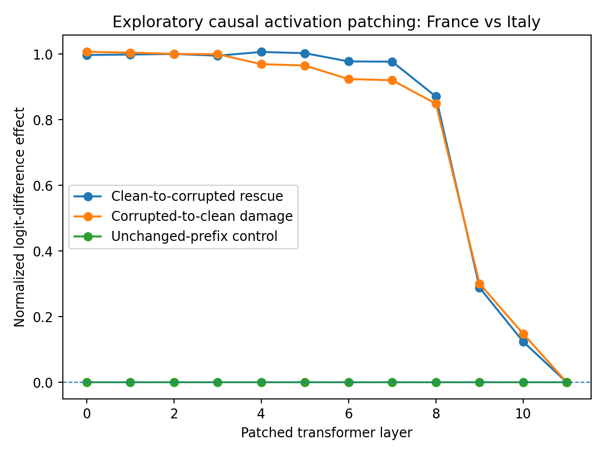
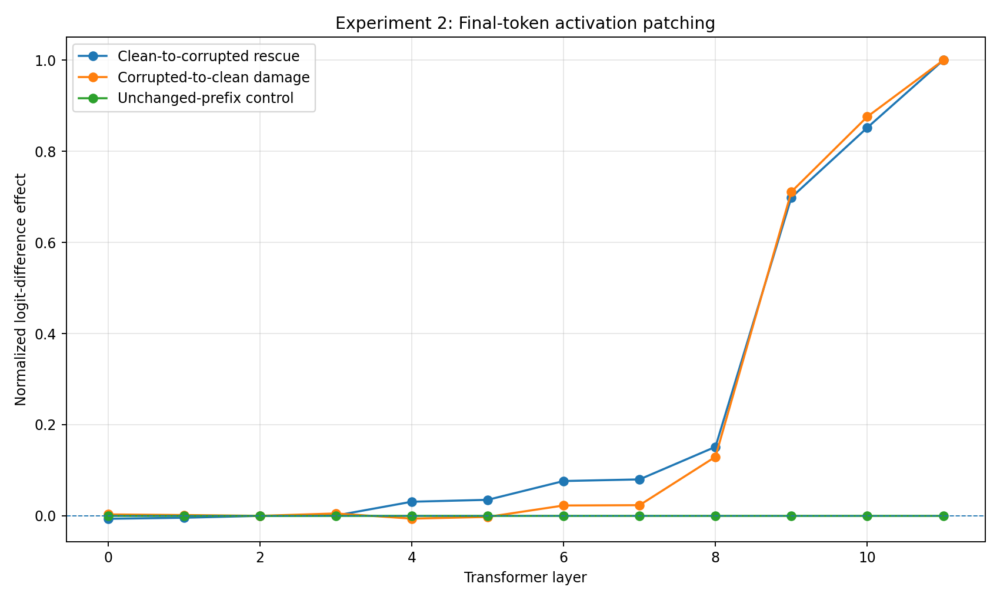

# GPT-2 Activation Patching: Two Exploratory Experiments

**Status:** Completed exploratory demonstrations of mechanistic interpretability methods.

## Overview

This project investigates how interventions on internal activations in GPT-2 affect next-token predictions.

Using Python, PyTorch, and TransformerLens, I compare activation patching at different token positions and transformer layers.

The longer-term objective is to apply these methods to research on sociolinguistic register, model robustness, and generalization.

## Research Question

How does the position and transformer layer of an activation intervention affect a language model's next-token predictions?

## Experimental Setup

**Clean prompt:** The capital of France is

**Corrupted prompt:** The capital of Italy is

**Compared predictions:** Paris versus Rome

**Method:** Residual-stream activation patching across GPT-2 transformer layers.

### Baseline Logit Differences

| Measurement | Logit Difference | Interpretation |
|---|---:|---|
| Clean prompt (France) | +1.405 | Prefers Paris over Rome |
| Corrupted prompt (Italy) | -4.417 | Prefers Rome over Paris |
| Behavioral separation | +5.822 | Passes the initial exploratory threshold |

The behavioral separation exceeds the notebook's threshold of 0.5. This is not a statistical significance test.

## Experiment 1: Country-Token Activation Patching

The first experiment replaces internal activations at the token distinguishing France from Italy.

### Results

- Layers 0–7: Approximately complete normalized recovery.
- Layers 8–10: Progressively weaker recovery.
- Layer 11: Zero recovery.
- Unchanged-prefix control: Zero throughout.

[View Experiment 1 numerical results](results/patching_results.csv)

## Experiment 2: Final-Token Activation Patching

The second experiment patches the final prompt-token position instead of the country-token position.

### Results

- Early layers: Very small intervention effects.
- Layer 9: Approximately 69.9% recovery.
- Layer 10: Approximately 85.2% recovery.
- Layer 11: Full normalized recovery.
- Unchanged-prefix control: Zero throughout.

[View Experiment 2 numerical results](results_final_position/patching_results.csv)

## Interpretation

The experiments demonstrate that activation-patching effects depend on both the transformer layer and the token position.

The contrasting results are consistent with the causal attention structure of GPT-2.

Patching the complete final-position activation at the final layer produces full recovery by design. This does not establish the discovery of a particular neuron, feature, or circuit.

## Limitations

These are exploratory experiments using one prompt pair.

They do not establish a unique internal mechanism or demonstrate sociolinguistic register representations.

Further research requires additional prompt pairs, stronger negative controls, replication, and more localized interventions.

## Reproducibility

The repository contains:

- A Jupyter notebook with both experiments.
- CSV files with quantitative results.
- Graphs illustrating activation-patching effects.

To reproduce the experiments:

1. Open the notebook in Google Colab.
2. Select Python 3 and preferably a T4 GPU.
3. Run the notebook cells in order.
4. Compare the results and visualizations.

The notebook has not yet been independently validated through a complete fresh runtime execution.

## Future Research

The next phase will apply causal intervention methods to my existing research project:

[Register Feature Family](https://github.com/Rinetta1981/register-feature-family)

The proposed research investigates which internal computations contribute to failures of generalization across linguistic-register combinations.

This will be a separate exploratory study; the existing project's failed out-of-distribution validity test remains part of the scientific record.

## Technologies

- Python
- PyTorch
- TransformerLens
- GPT-2
- Google Colab
- pandas and Matplotlib
